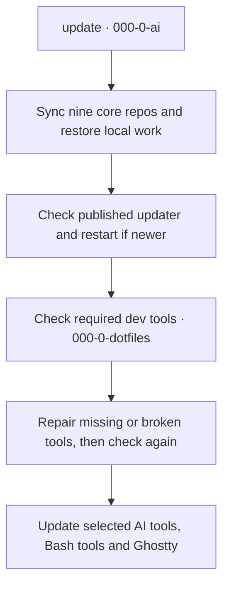

# GitHub Repository Manifest

Tracks repositories in the kairin GitHub account by tier, purpose, and status. A [local scheduled sync](docs/local-sync.md) refreshes descriptions and other GitHub metadata nightly, then catches up after startup when the computer missed a run.

GitHub account: [@kairin](https://github.com/kairin) 
Inventory retrieved with GitHub CLI (`gh api`) on 2026-10-15. 
Repositories are sorted alphabetically by repository name (case-insensitive).

**Total: 94 repositories in the published inventory.** This README lists 53 repositories across its tables (53 of 94); [PERSONAL-PROJECTS.md](PERSONAL-PROJECTS.md) provides descriptions for the 12 personal-project entries. Forks and archived repositories are listed in their own documents.

## 1 - Tier 000 - Core, Private

Private repositories with names beginning `000-` and no tier number (`111`, `222`, `333`, `444` or `999`).

| Repository | Visibility | Type | State | Default branch | Description |
|---|---|---|---|---|---|
| [000-0-ai](https://github.com/kairin/000-0-ai) | Private | Original | Active | `main` | Shared AI configuration and the update command for core repository sync, updater releases, development tool checks and application updates. |
| [000-0-dotfiles](https://github.com/kairin/000-0-dotfiles) | Private | Original | Active | `main` | Device setup guides and non-AI development tools: dev-doctor, dev-install and the shared tool catalog. |
| [000-0-password](https://github.com/kairin/000-0-password) | Private | Original | Active | `main` | Gives each command only the secret it needs from an encrypted password store. |
| [000-0-tables](https://github.com/kairin/000-0-tables) | Private | Original | Active | `main` | Defines the database stack and records database research, project usage and lessons for reuse across projects. |
| [000-0-workspace](https://github.com/kairin/000-0-workspace) | Private | Original | Active | `main` | Workspace layout, Git protection, local quality policy and the shared update startup procedure. |

## 2 - Tier 000 - Core, Public

Public repositories with names beginning `000-` and no tier number.

| Repository | Visibility | Type | State | Default branch | Description |
|---|---|---|---|---|---|
| [000-0-ASD-STE100](https://github.com/kairin/000-0-ASD-STE100) | Public | Original | Active | `main` | Provides Simplified Technical English writing rules and a prose checker to help readers understand technical documents. |
| [000-0-ghostty](https://github.com/kairin/000-0-ghostty) | Public | Original | Active | `main` | Ghostty terminal on RHEL 10: Flatpak built from the signed release, bash integration, and the current configuration. Updates run through the update command in 000-0-ai. |
| [000-0-manifest](https://github.com/kairin/000-0-manifest) | Public | Original | Active | `main` | Lists repositories in the kairin GitHub account, with separate records for forks and archived projects. |
| [000-0-tmux-cheat-sheet](https://github.com/kairin/000-0-tmux-cheat-sheet) | Public | Original | Active | `main` | Teaches basic tmux commands to keep AI agents running in separate terminal sessions, even after the terminal closes. |

## 3 - Tier 111 - Learning

Learning projects, public or private as the Visibility column shows.

| Repository | Visibility | Type | State | Default branch | Description |
|---|---|---|---|---|---|
| [000-111-learn](https://github.com/kairin/000-111-learn) | Public | Original | Active | `main` | Teaches Assembly and Fortran through small game tutorials to build fast programs that run close to the hardware. |
| [000-111-multi-agent-orchestration-learning](https://github.com/kairin/000-111-multi-agent-orchestration-learning) | Public | Original | Active | `main` | Learning resource for decomposing tasks, coordinating multiple agents, and reviewing handoffs, verification, and integration through historical case studies. Documentation only. |
| [000-111-workday-automation-learning](https://github.com/kairin/000-111-workday-automation-learning) | Public | Original | Active | `main` | Explores Rust browser shells and semantic browser automation so LLMs can inspect pages, operate controls and verify results. |

## 4 - Tier 222 - Personal

Personal projects — just for fun. Public or private as the Visibility column shows.

| Repository | Visibility | Type | State | Default branch |
|---|---|---|---|---|
| [000-222-caption](https://github.com/kairin/000-222-caption) | Private | Original | Active | `main` |
| [000-222-chatgpt-bulk-downloader](https://github.com/kairin/000-222-chatgpt-bulk-downloader) | Public | Original | Active | `main` |
| [000-222-civit-download](https://github.com/kairin/000-222-civit-download) | Private | Original | Active | `main` |
| [000-222-codex-playwright-cdp](https://github.com/kairin/000-222-codex-playwright-cdp) | Private | Original | Active | `main` |
| [000-222-comfyui-rtx5090](https://github.com/kairin/000-222-comfyui-rtx5090) | Private | Original | Active | `main` |
| [000-222-enom-projects](https://github.com/kairin/000-222-enom-projects) | Private | Original | Active | `main` |
| [000-222-graph-obsidian](https://github.com/kairin/000-222-graph-obsidian) | Private | Original | Active | `main` |
| [000-222-image-tools](https://github.com/kairin/000-222-image-tools) | Private | Original | Active | `main` |
| [000-222-my-comfyui-nodes](https://github.com/kairin/000-222-my-comfyui-nodes) | Public | Original | Active | `main` |
| [000-222-predict-c](https://github.com/kairin/000-222-predict-c) | Private | Original | Active | `main` |
| [000-222-rust-feh](https://github.com/kairin/000-222-rust-feh) | Public | Original | Active | `main` |
| [000-222-self-evolving-agentic-graph-memory-engine](https://github.com/kairin/000-222-self-evolving-agentic-graph-memory-engine) | Private | Original | Active | `main` |

Descriptions and details are in [PERSONAL-PROJECTS.md](PERSONAL-PROJECTS.md).

## 5 - Tier 333 - Work: Workday

Work projects related to Workday, named `000-333-workday-`. Every repository in this tier must be private and carry the standard GitHub rulesets: `protect-main`, `require-pull-request`, `no-branch-deletion`, `no-branch-rewrite` and `branch-naming` (new branches are named `YYYYMMDD-HHMMSS-short-name`). `python3 ~/Apps/000-0-ai/local-bin/github-protection.py` checks the rulesets; the Visibility column shows any repository that is not yet private.

| Repository | Visibility | Type | State | Default branch |
|---|---|---|---|---|
| [000-333-workday-automation-research](https://github.com/kairin/000-333-workday-automation-research) | Private | Original | Active | `main` |
| [000-333-workday-documents](https://github.com/kairin/000-333-workday-documents) | Private | Original | Active | `main` |
| [000-333-workday-procurement-forms](https://github.com/kairin/000-333-workday-procurement-forms) | Private | Original | Active | `main` |
| [000-333-workday-supplier-grab](https://github.com/kairin/000-333-workday-supplier-grab) | Private | Original | Active | `main` |
| [000-333-workday-supplier-kyocera](https://github.com/kairin/000-333-workday-supplier-kyocera) | Private | Original | Active | `main` |
| [000-333-workday-supplier-payments](https://github.com/kairin/000-333-workday-supplier-payments) | Private | Original | Active | `main` |
| [000-333-workday-supplier-telephony](https://github.com/kairin/000-333-workday-supplier-telephony) | Private | Original | Active | `main` |

## 6 - Tier 333 - Work: Other projects

All other work projects, named `000-333-`. Every repository in this tier must be private, except `000-333-stay-up`: it is a public tool for anyone to use and must contain no personal or work details. Every repository in this tier must also carry the standard GitHub rulesets: `protect-main`, `require-pull-request`, `no-branch-deletion`, `no-branch-rewrite` and `branch-naming` (new branches are named `YYYYMMDD-HHMMSS-short-name`). `python3 ~/Apps/000-0-ai/local-bin/github-protection.py` checks the rulesets; the Visibility column shows any repository that is not yet private.

| Repository | Visibility | Type | State | Default branch |
|---|---|---|---|---|
| [000-333-airbase-apps](https://github.com/kairin/000-333-airbase-apps) | Private | Original | Active | `main` |
| [000-333-audit-001](https://github.com/kairin/000-333-audit-001) | Private | Original | Active | `main` |
| [000-333-BCM](https://github.com/kairin/000-333-BCM) | Private | Original | Active | `main` |
| [000-333-bcm-redo](https://github.com/kairin/000-333-bcm-redo) | Private | Original | Active | `main` |
| [000-333-BCM-redo-01-2026-09-28](https://github.com/kairin/000-333-BCM-redo-01-2026-09-28) | Private | Original | Active | `main` |
| [000-333-careers-gov](https://github.com/kairin/000-333-careers-gov) | Private | Original | Active | `main` |
| [000-333-cas-leave](https://github.com/kairin/000-333-cas-leave) | Private | Original | Active | `main` |
| [000-333-email-archive](https://github.com/kairin/000-333-email-archive) | Private | Original | Active | `main` |
| [000-333-eml-convert](https://github.com/kairin/000-333-eml-convert) | Private | Original | Active | `main` |
| [000-333-kyo-m](https://github.com/kairin/000-333-kyo-m) | Private | Original | Active | `main` |
| [000-333-nas](https://github.com/kairin/000-333-nas) | Private | Original | Active | `main` |
| [000-333-og-digest](https://github.com/kairin/000-333-og-digest) | Private | Original | Active | `main` |
| [000-333-OG-tools](https://github.com/kairin/000-333-OG-tools) | Private | Original | Active | `main` |
| [000-333-Problem-Craft](https://github.com/kairin/000-333-Problem-Craft) | Private | Original | Active | `main` |
| [000-333-problem-craft-base](https://github.com/kairin/000-333-problem-craft-base) | Private | Original | Active | `main` |
| [000-333-pst-eml-convert-01](https://github.com/kairin/000-333-pst-eml-convert-01) | Private | Original | Active | `main` |
| [000-333-pst-eml-not-done](https://github.com/kairin/000-333-pst-eml-not-done) | Private | Original | Active | `main` |
| [000-333-screenforge-d002](https://github.com/kairin/000-333-screenforge-d002) | Private | Original | Active | `main` |
| [000-333-screenforge-signage](https://github.com/kairin/000-333-screenforge-signage) | Private | Original | Active | `main` |
| [000-333-stay-up](https://github.com/kairin/000-333-stay-up) | Public | Original | Active | `main` |
| [000-333-vba-scripts](https://github.com/kairin/000-333-vba-scripts) | Private | Original | Active | `main` |
| [000-333-WOG-Ref](https://github.com/kairin/000-333-WOG-Ref) | Private | Original | Active | `main` |

## 7 - Tier 444 - Forks

Forked repositories are listed separately in [FORKS.md](FORKS.md).

## 8 - Tier 999 - Archived

Archived repositories are listed in [ARCHIVED.md](ARCHIVED.md).

## How this repository works

The tables and repository counts on this page, [PERSONAL-PROJECTS.md](PERSONAL-PROJECTS.md), [FORKS.md](FORKS.md), and [ARCHIVED.md](ARCHIVED.md) are generated. Do not edit the tables by hand, because the next sync replaces them. Headings and other text stay as written.

| Path | Contents |
|---|---|
| `scripts/sync_manifest.py` | Script that reads the repository list from GitHub and regenerates the four pages |
| `inventory-config.json` | Approved repository IDs and their categories (`personal`, `work`, or `auto`), plus the optional `unlisted_private` policy. Tiers of `000-` names come from the name prefix, not the category |
| `systemd/` | Timer and service that run the script each night on one computer |
| `tests/` | Unit tests for the script |
| `docs/local-sync.md` | What the script does, installation, logs, headless setup, and troubleshooting |

There is no GitHub Actions workflow. The sync runs on a computer where the systemd timer is installed. By default, a new private repository stops the sync until it has an entry in `inventory-config.json`; the explicit `unlisted_private: "omit"` policy excludes unlisted private or internal records from the published inventory and reports only their count. For the steps, see [docs/local-sync.md](docs/local-sync.md).

The nightly inventory sync updates repository listings. It does not run
`update`, install development tools or repair applications. The two processes
are separate. Generated descriptions come from GitHub About. See
[core description maintenance](docs/local-sync.md#core-description-maintenance)
for the wording that reflects the new tool ownership.

## Core repository sync in `update`

Updater **1.0.002** starts each normal run with the nine core repositories.
It fetches remote `main` and advances local `main` only when a fast-forward
is possible. It temporarily saves staged, unstaged and untracked changes in
a local Git recovery snapshot. It restores the original working branch and
local changes before it starts the next repository. Ignored files stay in
place. It keeps the recovery snapshot and records incomplete restoration.

This routine sync does not commit or push unfinished work. If a repository
cannot sync or restore its local work, the command reports an incomplete
result and stops before updater replacement or application updates. Existing
merge operations, diverged history and unresolved recovery records need
attention. The command does not discard local commits or force a reset.

After all nine repositories sync and restore, the command checks published
`update-v*` releases in `000-0-ai`. It installs newer updater code from the
exact published tag, then restarts once with the original arguments. It does
not install unreleased working tree code. Application updates run last.
`--only` limits application updates, not the nine-repository sync.
`--version` and `--check-self` remain local checks. `--dry-run` makes no changes.

The owner release sequence is `1.0.001` through `1.0.999`, then `1.1.0`.
This is the updater version scheme, not application version pinning.
See the [shared update procedure](../000-0-ai/README.md#update-command) and
[repository sync requirements](../000-0-workspace/docs/repository-protection.md#routine-core-sync-in-update).

## Update startup and automatic calls

Run `update` as your normal user for routine maintenance. It calls the doctor
and installer automatically when needed.

This diagram shows the successful path. A failed sync, release check or tool
repair stops the process before app updates. Healthy tools need no repair.

| Need | Command |
|---|---|
| Routine maintenance | `update` |
| Read-only tool check | `dev-doctor` |
| Show a repair plan | `dev-install` |
| Apply repairs | `dev-install --apply` |

Only system-package repairs through DNF need sudo. If needed, run `sudo -v`
first. Repairs use `sudo -n` and fail if authorization expires.
Never run `sudo update`. User-owned binary and Ruff repairs need no sudo.

`000-0-ai` owns the updater. `000-0-dotfiles` owns the doctor, installer and
catalog. `000-0-workspace` owns the
[full procedure](../000-0-workspace/docs/update-and-development-tools.md),
including first setup, failure paths, preview limits and the ownership table.
See [dotfiles](../000-0-dotfiles/README.md#development-tools) for tool details.

## Workflow review — 2026-10-15

No manifest runtime defect was found. This repository inventories the nine core
repositories; it does not prove updater, tool or application health. Generated
inventory tables remain generated, and GitHub About remains the source for
repository descriptions.

When workflow ownership changes, update the authoritative repository
description and the manifest source, regenerate the inventory, and link the
owner's [adversarial workflow review](../000-0-workspace/docs/update-workflow-review-2026-10-15.md)
without copying its full findings here.

## Office toolset and Node.js policy (2026-10-15)

The office setup now uses updater `1.0.002` and development tools `1.0.002`.
The office work did not install or change the nightly inventory timer.
The repository tables remain generated from GitHub metadata.
The shared Node.js LTS policy belongs to the toolset, not the inventory job.

See the [office installation record and shared version policy](../000-0-workspace/docs/office-toolset-2026-10-15.md).
